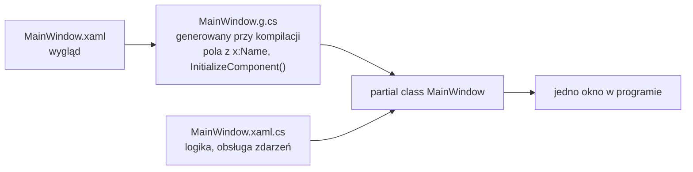
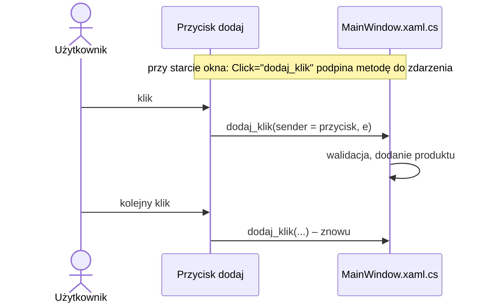

# XAML i code-behind

## Dwa pliki – jedno okno
Każde okno WPF składa się z dwóch plików:

| Plik | Zawartość |
|---|---|
| `MainWindow.xaml` | **wygląd** – kontrolki, układ, style (znaczniki XAML) |
| `MainWindow.xaml.cs` | **logika** – obsługa zdarzeń, dane (C#) – tzw. *code-behind* |

Oba pliki opisują **tę samą klasę**. W XAML wskazuje ją atrybut `x:Class`, a w C# klasa jest oznaczona jako `partial` – kompilator skleja obie części w jedną.

```xml
<Window x:Class="WpfApp.MainWindow" ...>
```
```cs
public partial class MainWindow : Window
{
    public MainWindow()
    {
        InitializeComponent();   // tworzy kontrolki opisane w XAML
    }
}
```


Bez `InitializeComponent()` okno będzie puste, a pola z `x:Name` będą miały wartość `null`.

## `x:Name` – dostęp do kontrolki z kodu
```xml
<DataGrid x:Name="dgprodukty" Grid.Column="0" IsReadOnly="True" />
```
```cs
dgprodukty.ItemsSource = produkty;
```
`x:Name` tworzy w klasie okna **pole o tej nazwie**, przez które odwołujemy się do kontrolki w C#.
Bez nazwy kontrolka jest widoczna, ale z kodu nie da się jej łatwo użyć.

`Name="..."` działa tak samo dla kontrolek (np. `<Button Name="addProduct">`); `x:Name` działa dla każdego elementu XAML.

## Przycisk
```xml
<Button Content="Dodaj" />
<!-- lub -->
<Button>Dodaj</Button>
```
Kontrolka nazywa się **`Button`**, napis ustawiamy atrybutem `Content` lub wpisując tekst między znacznikami.

## Zdarzenia – atrybut `Click`
```xml
<Button Content="dodaj" Click="dodaj_klik" />
```
```cs
private void dodaj_klik(object sender, RoutedEventArgs e)
{
    // ...
}
```


- Atrybut **`Click`** wskazuje nazwę metody w code-behind.
- Metoda wykona się **za każdym razem, gdy użytkownik kliknie przycisk** (także Enter/Spacja, gdy przycisk ma fokus).
- `sender` – kontrolka, która wywołała zdarzenie (tu ten przycisk); `e` – dane zdarzenia.
- Nazwa w XAML musi dokładnie odpowiadać nazwie metody – literówka da błąd kompilacji.

> W Visual Studio: wpisz `Click="` i wybierz **&lt;New Event Handler&gt;** – metoda zostanie wygenerowana automatycznie.

## Pytania kontrolne
1. Jaką rolę pełni `MainWindow.xaml.cs` względem `MainWindow.xaml`?
2. Do czego służy atrybut `x:Name`?
3. Jak nazywa się kontrolka wyświetlająca przycisk? Napisz w XAML przycisk z napisem „Dodaj”.
4. Jak nazywa się atrybut wskazujący metodę wykonywaną po kliknięciu?
5. Kiedy zostanie wywołana metoda `dodaj_klik`?
