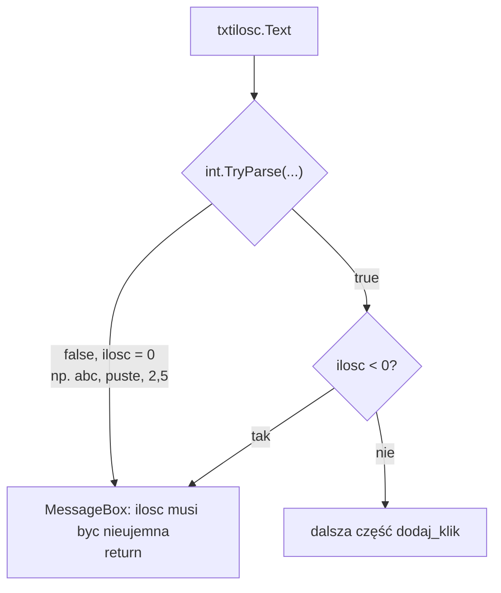
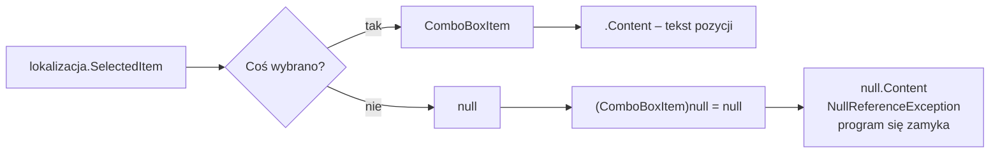

# Walidacja danych i typowe błędy

## `int.TryParse` – bezpieczna zamiana tekstu na liczbę
```cs
int ilosc;
if (!int.TryParse(txtilosc.Text, out ilosc) || ilosc < 0)
{
    MessageBox.Show("ilosc musi byc nieujemna");
    return;
}
```
`TryParse` **nie rzuca wyjątku**. Zwraca:
- `true` – udało się, liczba trafia do zmiennej z `out`,
- `false` – tekst nie jest liczbą całkowitą, a zmienna `out` dostaje `0`.

| Wpisano | Wynik `TryParse` | `ilosc` | Komunikat? |
|---|---|---|---|
| `12` | `true` | 12 | nie |
| `-3` | `true` | -3 | tak (`< 0`) |
| `abc` | **`false`** | **0** | **tak** |
| (puste) | `false` | 0 | tak |
| `2,5` | `false` | 0 | tak |



Dla `abc` warunek `!false` jest prawdziwy, więc pojawia się komunikat i `return` przerywa metodę.

Porównanie: `int.Parse("abc")` rzuci `FormatException` i – bez `try/catch` – zamknie program.

## Rzutowanie `SelectedItem` gdy nic nie wybrano
```cs
Localizacja.Text = "Lokalizacja: " + ((ComboBoxItem)lokalizacja.SelectedItem).Content.ToString();
```
Gdy w ComboBox **nic nie wybrano**, `SelectedItem` ma wartość `null`.
Rzutowanie `(ComboBoxItem)null` daje `null`, a odwołanie `.Content` na `null` rzuca **`NullReferenceException`**.
Nieobsłużony wyjątek w obsłudze zdarzenia **zamyka aplikację**.



Poprawnie – sprawdzenie przed użyciem:
```cs
if (lokalizacja.SelectedItem is ComboBoxItem item)
{
    Localizacja.Text = "Lokalizacja: " + item.Content;
}
else
{
    MessageBox.Show("Wybierz lokalizację");
}
```
> Gdy ComboBox jest wypełniany przez `ItemsSource` (np. listą stringów), `SelectedItem` **nie jest** `ComboBoxItem` – rzutowanie rzuci `InvalidCastException`. Wtedy używamy `lokalizacja.SelectedItem as string` lub `lokalizacja.Text`.

## `SelectedIndex == -1`
```cs
if (productList.SelectedIndex == -1) { return; }
Products.RemoveAt(productList.SelectedIndex);
```
`SelectedIndex` to numer zaznaczonego wiersza (od 0). **`-1` oznacza, że nic nie jest zaznaczone.**
Bez tego warunku `RemoveAt(-1)` rzuci `ArgumentOutOfRangeException`.

| Właściwość | Gdy nic nie zaznaczono |
|---|---|
| `SelectedIndex` | `-1` |
| `SelectedItem` | `null` |

## Zasada
Każda dana od użytkownika (pole tekstowe, wybór z listy, zaznaczenie w tabeli) może być **pusta lub błędna**. Sprawdzamy ją **przed** użyciem i przerywamy metodę przez `return` z komunikatem.

## Pytania kontrolne
1. Jaką wartość zwróci `int.TryParse`, gdy w polu wpisano `abc`? Jaką wartość dostanie `ilosc`?
2. Dlaczego rzutowanie `((ComboBoxItem)lokalizacja.SelectedItem).Content` zamyka program, gdy nic nie wybrano?
3. Co oznacza warunek `productList.SelectedIndex == -1`?
