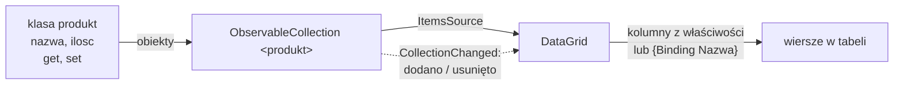
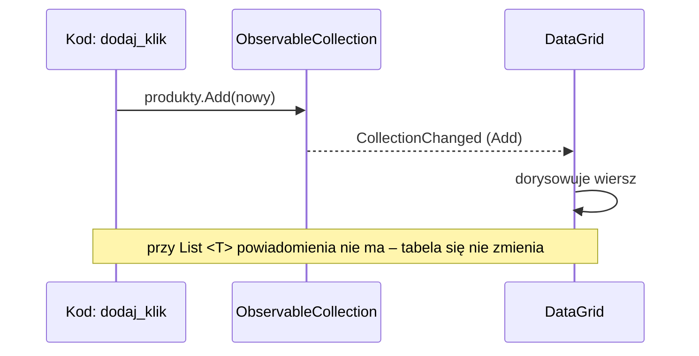

# Wiązanie danych – DataGrid i ObservableCollection

## Jak to działa razem


## Klasa modelu – właściwości `{ get; set; }`
```cs
public class produkt
{
    public string nazwa { get; set; }
    public int ilosc { get; set; }
}
```
`{ get; set; }` zamienia pole w **właściwość** (*property*). Kompilator sam tworzy ukryte pole i metody odczytu/zapisu.

Mechanizm wiązania danych WPF (`Binding`) oraz automatyczne kolumny `DataGrid` działają **tylko z publicznymi właściwościami**. Zwykłe pole:
```cs
public string nazwa;   // pole – DataGrid go NIE zobaczy
```
nie pojawi się w tabeli.

> Konwencja C#: nazwy klas i właściwości wielką literą – `Produkt`, `Nazwa`, `Ilosc`.

## Kolekcja – `ObservableCollection` zamiast `List`
```cs
using System.Collections.ObjectModel;

ObservableCollection<produkt> produkty = new ObservableCollection<produkt>();
```
`ObservableCollection` **powiadamia** kontrolkę o każdym dodaniu, usunięciu i wyczyszczeniu (implementuje `INotifyCollectionChanged`). DataGrid odświeża się sam.

| | `List<T>` | `ObservableCollection<T>` |
|---|---|---|
| `Add` / `Remove` widoczne w tabeli | **nie** – trzeba ręcznie `dgprodukty.Items.Refresh()` | **tak**, od razu |



> Zmiana **wartości** w istniejącym obiekcie (np. `p.ilosc = 5`) nie odświeży wiersza – do tego klasa musi implementować `INotifyPropertyChanged`.

## Podpięcie danych – `ItemsSource`
```xml
<DataGrid x:Name="dgprodukty" Grid.Column="0" IsReadOnly="True" />
```
```cs
public MainWindow()
{
    InitializeComponent();
    dgprodukty.ItemsSource = produkty;
}
```
`ItemsSource` wskazuje kolekcję, którą kontrolka ma wyświetlać – **jeden obiekt = jeden wiersz**.
Ustawiamy to raz; dalej pracujemy tylko na kolekcji:
```cs
produkty.Add(new produkt { nazwa = "kabel", ilosc = 10 });   // wiersz pojawi się w tabeli
```

## Skąd DataGrid wie, jakie kolumny pokazać?
Domyślnie `AutoGenerateColumns="True"`. DataGrid sprawdza typ elementów kolekcji i tworzy **kolumnę dla każdej publicznej właściwości**. Nagłówek = nazwa właściwości (`nazwa`, `ilosc`).

## Własne kolumny i `Binding`
```xml
<DataGrid x:Name="dgprodukty" AutoGenerateColumns="False">
    <DataGrid.Columns>
        <DataGridTextColumn Header="Nazwa" Binding="{Binding Nazwa}"/>
        <DataGridTextColumn Header="Ilość" Binding="{Binding Ilosc}"/>
    </DataGrid.Columns>
</DataGrid>
```
- `Header` – tekst nagłówka,
- `{Binding Nazwa}` – nazwa **właściwości** obiektu, z której brana jest wartość (wielkość liter ma znaczenie).
- `AutoGenerateColumns="False"` – inaczej obok własnych pojawią się też kolumny wygenerowane.

### Literówka w `Binding`
```xml
<DataGridTextColumn Header="Nazwa" Binding="{Binding Nazwaa}"/>
```
Program się **nie wywali** i **skompiluje się**. Kolumna „Nazwa” będzie **pusta** w każdym wierszu.
Błąd widać tylko w Visual Studio: okno **Output** lub **XAML Binding Failures** – komunikat o braku właściwości `Nazwaa`.

## Pytania kontrolne
1. Dlaczego pola klasy `produkt` zapisano z `{ get; set; }`?
2. Dlaczego produkty przechowano w `ObservableCollection`, a nie w `List`?
3. Co robi linia `dgprodukty.ItemsSource = produkty;`?
4. Skąd DataGrid wie, jakie kolumny wyświetlić, skoro w XAML nie zdefiniowano żadnej kolumny?
5. Co wyświetli kolumna „Nazwa” przy `{Binding Nazwaa}`?
