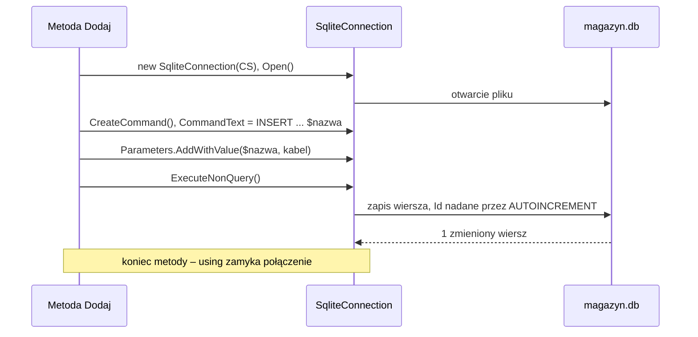

# Baza danych SQLite – Microsoft.Data.Sqlite

## SQLite
Baza danych w **jednym pliku** (np. `magazyn.db`) obok programu. Nie wymaga serwera ani instalacji – wystarczy pakiet NuGet.

## Instalacja pakietu
Visual Studio: PPM na projekt → **Manage NuGet Packages** → wyszukaj `Microsoft.Data.Sqlite` → Install.
lub w terminalu:
```bash
dotnet add package Microsoft.Data.Sqlite
```

## Połączenie i tabela
```cs
using Microsoft.Data.Sqlite;

const string CS = "Data Source=magazyn.db";   // plik zostanie utworzony, jeśli nie istnieje
```
```sql
CREATE TABLE IF NOT EXISTS Produkty (Id INTEGER PRIMARY KEY AUTOINCREMENT, Nazwa TEXT);
```

## Schemat każdego zapytania
1. utwórz i otwórz połączenie,
2. utwórz polecenie i wpisz SQL,
3. dodaj parametry,
4. wykonaj,
5. zamknij połączenie (`using` robi to automatycznie).



## Dodawanie – `INSERT`
```cs
public void Dodaj(string nazwa)
{
    using var conn = new SqliteConnection(CS);
    conn.Open();

    using var cmd = conn.CreateCommand();
    cmd.CommandText = "INSERT INTO Produkty (Nazwa) VALUES ($nazwa)";
    cmd.Parameters.AddWithValue("$nazwa", nazwa);
    cmd.ExecuteNonQuery();
}
```
- `Id` pomijamy – `AUTOINCREMENT` nada je sam.
- `ExecuteNonQuery()` – dla `INSERT`, `UPDATE`, `DELETE`, `CREATE`; zwraca liczbę zmienionych wierszy.
- `using` – zamyka połączenie po wyjściu z metody, także gdy poleci wyjątek.

### Dlaczego parametr, a nie sklejanie tekstu?
```cs
// ŹLE – SQL injection
cmd.CommandText = "INSERT INTO Produkty (Nazwa) VALUES ('" + nazwa + "')";
```
Nazwa `kabel'); DROP TABLE Produkty; --` zostałaby wykonana jako SQL. Apostrof w zwykłej nazwie (`O'Neil`) też zepsuje zapytanie.
Parametr `$nazwa` przekazuje wartość osobno od treści SQL – zawsze bezpiecznie.

## Tworzenie tabeli przy starcie
```cs
public void Inicjalizuj()
{
    using var conn = new SqliteConnection(CS);
    conn.Open();
    using var cmd = conn.CreateCommand();
    cmd.CommandText = "CREATE TABLE IF NOT EXISTS Produkty (Id INTEGER PRIMARY KEY AUTOINCREMENT, Nazwa TEXT)";
    cmd.ExecuteNonQuery();
}
```

## Odczyt – `SELECT`
```cs
public List<string> Pobierz()
{
    var wynik = new List<string>();
    using var conn = new SqliteConnection(CS);
    conn.Open();
    using var cmd = conn.CreateCommand();
    cmd.CommandText = "SELECT Nazwa FROM Produkty";

    using var reader = cmd.ExecuteReader();
    while (reader.Read())
    {
        wynik.Add(reader.GetString(0));   // 0 = pierwsza kolumna z SELECT
    }
    return wynik;
}
```

| Metoda | Kiedy |
|---|---|
| `ExecuteNonQuery()` | zapytania zmieniające dane |
| `ExecuteReader()` | `SELECT` zwracający wiele wierszy |
| `ExecuteScalar()` | `SELECT` zwracający jedną wartość, np. `COUNT(*)` |

## Pytania kontrolne
1. Napisz metodę `Dodaj(string nazwa)`, która wstawia produkt do tabeli `Produkty`.
2. Dlaczego nie podajemy wartości `Id` w `INSERT`?
3. Dlaczego używamy parametrów zamiast sklejać SQL z tekstu?
